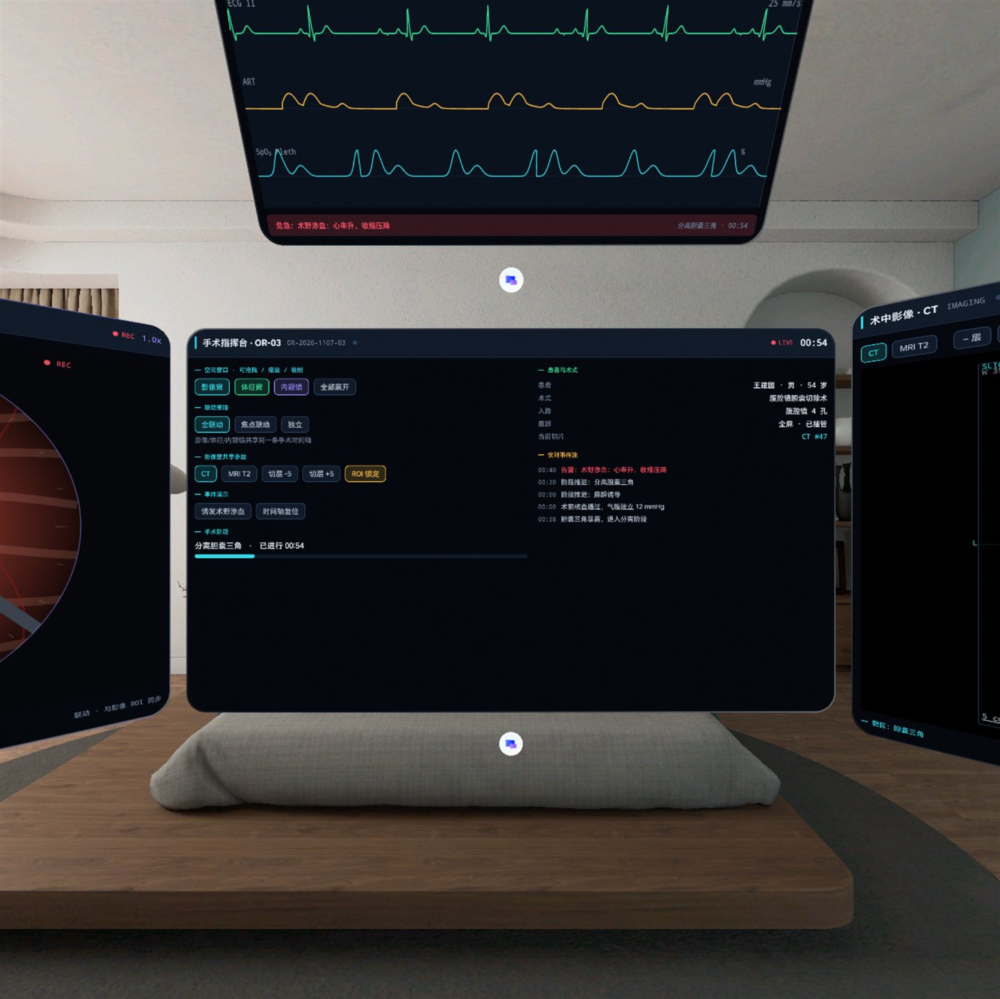
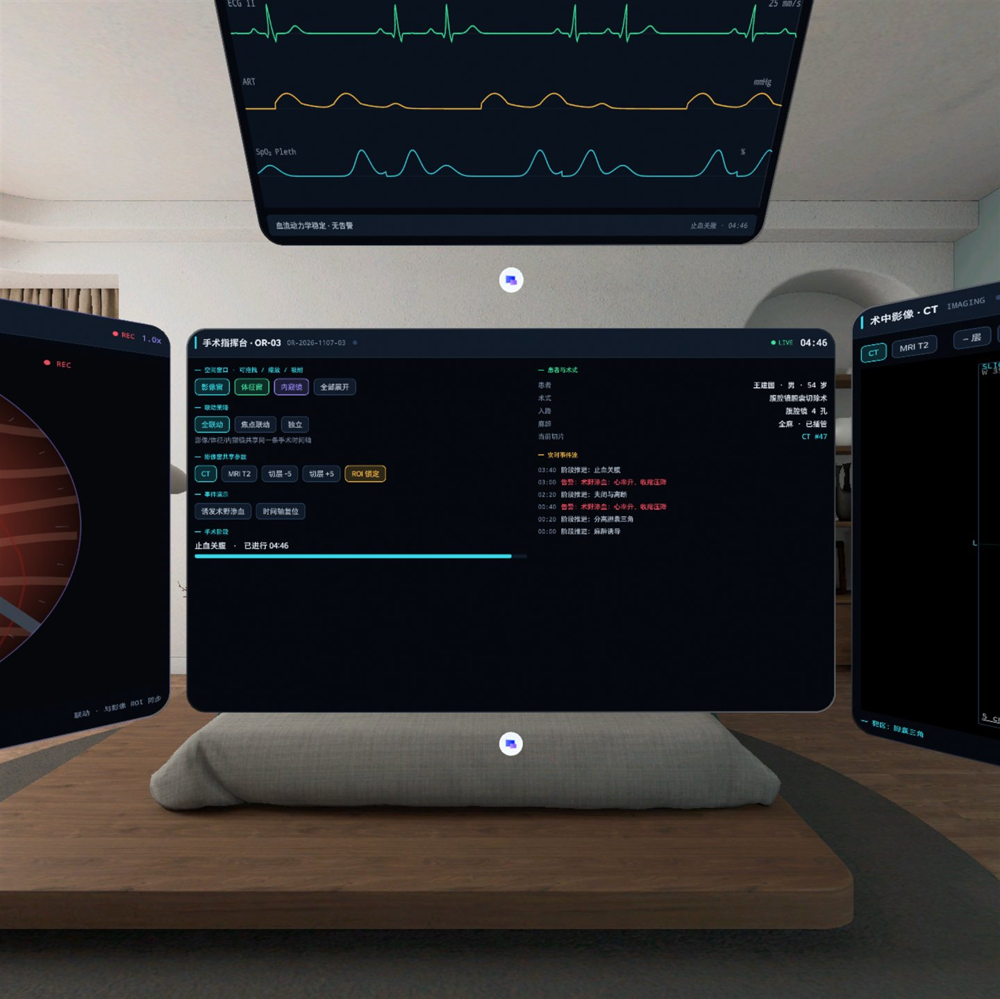
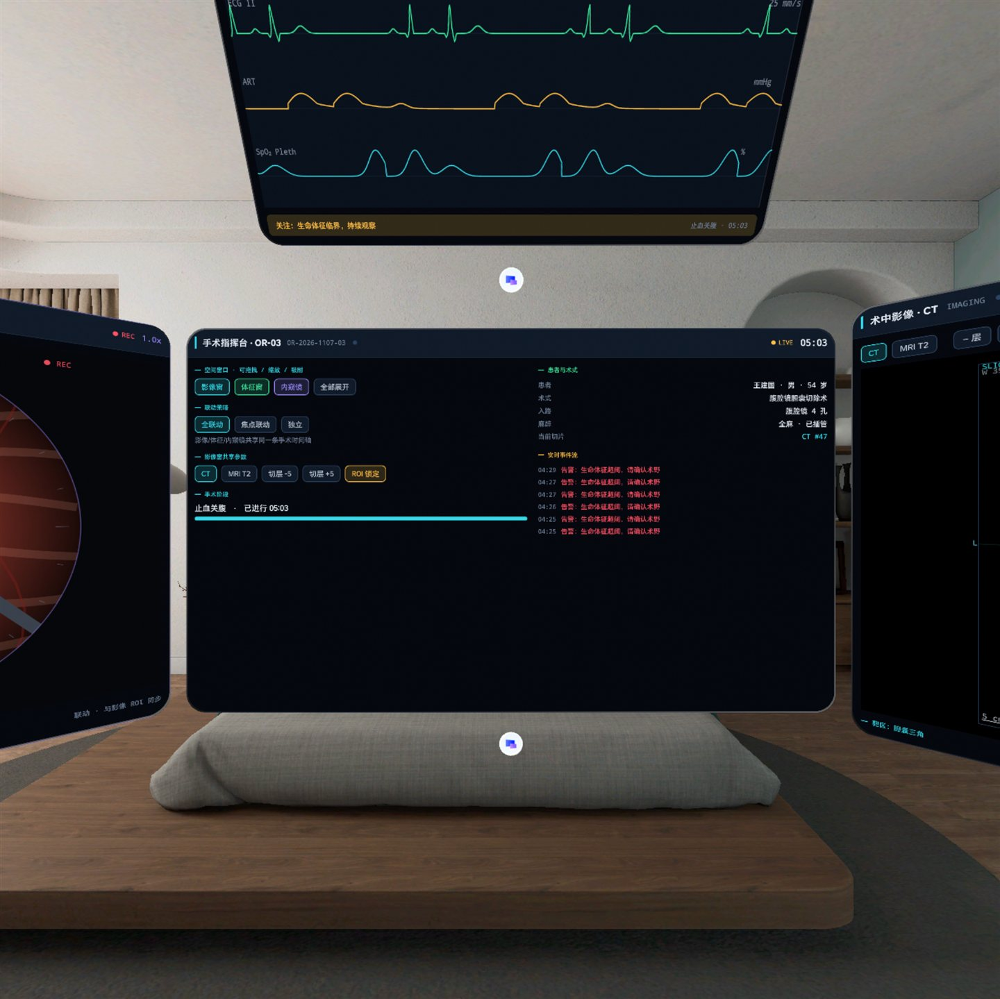

# SurgPanel · Spatial Multi-Window Intraoperative Panel

A spatial computing prototype for the **PICO Space Program 2026**, entering the *Best PICO Spatial Application* track.
Inside a single operating room it pulls the four information streams a surgeon must watch at once into space: **CT/MRI slices, live vital signs, the endoscopic field, and a master console**.
Each stream lives in its own `WindowContainer` and can be freely placed, resized and snapped by head and hand gestures, while all four stay synchronized through a shared session state.

> Stack: **pure Kotlin + PICO Spatial SDK 6.2.8 (Compose for Spatial), no 3D engine dependency**
> Headset-free development: PICO Emulator (managed by pico-cli, x86_64 image)
> Release: **v1.3.0** (versionCode 4) - Spatial SDK 6.2.8 toolchain upgrade (zero source change), pico-cli 0.7.0

**Language:** English | [简体中文](README.zh-CN.md)


Architecture and Code Review details are available in docs/code_review.md
Toolchain upgrade record (6.1.9 -> 6.2.8): [docs/upgrade-6.2.8.md](docs/upgrade-6.2.8.md)

---

## 1. Build and run

```powershell
# Environment variables (ASCII-only paths, see the note below)
$env:PICO_HOME="<pico-home>"
$env:ANDROID_HOME="<android-sdk>"

# Toolchain: pico-cli 0.7.0, installed side by side so 0.6.1 stays intact
npm install --prefix C:\DevTools\pico-cli @picoxr/pico-cli@0.7.0
# Entry point: C:\DevTools\pico-cli\node_modules\.bin\pico-cli.cmd

# Build
cd <project-root>
.\gradlew.bat assembleDebug

# Emulator, install, launch (pico-cli 0.7.0)
pico-cli emulator start --avd Pico_SurgPanel
pico-cli app install app\build\outputs\apk\debug\app-debug.apk --replace
pico-cli app launch com.cwj.surgpanel
pico-cli capture screenshot --out shots/live.png
```

**Path constraint.** Java and GraalVM based tooling fails on non-ASCII paths (non-English Windows user names included). Keep `PICO_HOME`, `ANDROID_HOME` and `GRADLE_USER_HOME` on ASCII-only directories such as `C:\DevTools\...`, otherwise `pico-cli setup` and the Gradle daemon fail with `Illegal char <?>` or a missing `javaagent` JAR.

---

## 2. Spatial layout

| Container ID | Content | Form | Size (dp) | Initial placement |
| --- | --- | --- | --- | --- |
| `surgical-console` (default container) | Master console: window toggles, linkage policy, patient info, event log | Planar | 1080x640 | Directly in front of the user |
| `imaging-panel` | CT/MRI axial slice, measurement, window width/level, slice stepping | Planar | 860x700 | To the **right** of the console |
| `vitals-panel` | Heart rate, blood pressure, SpO2, EtCO2, three-lead waveforms | Planar | 780x440 | **Above** the console |
| `scope-panel` | Circular endoscopic field with instrument, fold and bleeding rendering | Planar | 720x640 | To the **left** of the console |
| `focus-panel` | Incident focus: virtual magnification, cut-away cross-section, findings, countermeasures | Planar | 760x780 | Left of the console, raised to the front when an anomaly fires |
| `record-panel` | Touch-free record review: history entries, imaging and allergy summary, streamed as text | Planar | 560x400 | Closed by default; right of the imaging window once summoned |

- Placement uses the official `Placement.placement(anchor, Orientation.Right/Top/Left, offset)`. Anchors are resolved by container ID from `PlacementContext.containers`, with a `Placement.none()` fallback so a missing anchor never crashes startup.
- Panels open and close through `LocalSpatialNavigator.current.openWindowContainer(id, tag)` / `closeWindowContainer(id, tag)`. A fixed `tag` puts the call in **reuse mode**: reopening brings the existing window to the front instead of stacking duplicates.
- Dragging, resizing and distance adaptation are handled natively by the system `WindowContainer` (`worldscaletype=1`, Dynamic). Panels never implement their own gesture translation, so the feel stays identical to system gestures.

---

## 3. Module layout

```
com.cwj.surgpanel
├── Main.kt                    Spatial entry: DefaultWindowContainer plus three WindowContainer declarations and anchoring
├── core/
│   ├── SurgicalSession.kt     Global session state (Compose State, single source): vitals, slice, modality, operating mode, incident, event log
│   ├── SignalEngine.kt        Pure signal generation: ECG/ABP/pulse waveforms, tissue density field, surgical field texture
│   ├── AppMode.kt             Operating-mode switch (product / demo) plus display badge
│   ├── AiModels.kt            Incident case, focus stages, findings, actions, request/response contracts
│   ├── AiController.kt        Five-stage chain: localise -> magnify -> cut away -> analyse -> countermeasures
│   ├── AiNarrator.kt          Streaming typewriter for narrative blocks: token queue, one job per block, cancellable
│   ├── CaseRecord.kt          Prior-history entries served to the touch-free record panel
│   ├── VoiceCommandRouter.kt  Voice grammar: phrase normalisation, bleeding-query match, alarm intent dispatch
│   ├── WindowPoseModel.kt     Designed world pose of the five windows (metres, origin at the console centre)
│   └── PerfGovernor.kt        Visual-only degradation: redraw rate and waveform sampling stride, nothing else
├── data/
│   ├── InstrumentPort.kt      Device ports (vitals / imaging / endoscope) and the registry product mode attaches to
│   └── AiAdvisor.kt           AI API client: remote HTTP JSON inference, local rule engine as fallback
├── platform/
│   ├── LaunchActivity.kt      Host activity
│   ├── SpatialApplication.kt  Boots the spatial tree, starts the surgery clock, attaches gaze and pinch
│   ├── SessionClock.kt        100 ms data bus: vitals drift, external device frames, bleeding events, alarm grading, phase progression
│   ├── GazePinchController.kt Eye ray, HMD ray fallback, dwell highlight and pinch confirm over the five windows
│   └── VoiceInput.kt          System SpeechRecognizer wrapper behind the console microphone button
└── ui/
    ├── theme/Palette.kt       Dark operating-room palette (low luminance, low saturation, layered alarm colors)
    ├── common/PanelFrame.kt   Panel chrome: status lamp, pill buttons, primary button, key-value rows, frame clock
    ├── console/ConsolePage.kt Master console, mode switch and front-panel drill button
    ├── imaging/ImagingPanel.kt
    ├── vitals/VitalsPanel.kt
    ├── scope/ScopePanel.kt
    ├── focus/FocusPanel.kt    Incident focus: magnification, cut-away cross-section, findings, countermeasures
    └── record/RecordPanel.kt  Touch-free record review: gaze / voice summon, streamed history, NO-TOUCH badge
```

**Gaze, pinch and voice.** `GazePinchController` casts the eye forward vector against the five window planes, keeps the nearest hit and lights a panel once the same hit holds for a third of its 750 ms dwell window. A hand pinch above 0.82 on a lit panel fires the confirm handler registered for that panel and then stays locked for 700 ms. When the eye provider is unavailable the HMD ray takes over, so the highlight still works on hardware without an eye tracker. The console microphone button feeds the system `SpeechRecognizer`; the phrase *立刻查看出血点* (and a small set of paraphrases) sets the alarm to critical, marks the bleeding flag and brings the focus window forward through the same state the instrument path uses.

**Performance contract.** `PerfGovernor` may only throttle what is drawn: `visualHz` 60 / 30 / 20 and `waveStride` 2 / 3.4 / 5.They affect the canvas waveform alone. `SessionClock` keeps its 100 ms daemon tick and the alarm grading untouched in every level, numeric readouts and the red alarm frame repaint on every state change, curves are interpolated with a frame-rate independent step so a lower rate never looks like a jump, and no thread is ever suspended to save power. `docs/architecture.md` section 15 states the contract in full.

**State and view are decoupled.** Every panel only reads `SurgicalSession`; every write is centralized in `SessionClock` (a background daemon thread). Closing, reopening or moving a window therefore never interrupts the data flow, and swapping in real device sources later means replacing `SessionClock` with a DICOM / patient monitor / endoscope SDK adapter without touching any panel.

---

## 4. Operating modes

The console toggles between two modes. Both drive the same four panels and the same session state, so the spatial layout does not change when a real device is plugged in.

| | Demo mode | Product mode |
| --- | --- | --- |
| Data source | Local simulation inside `SessionClock`: deterministic and repeatable | Frames polled from `InstrumentRegistry`; local simulation only as fallback when no device is attached |
| Trigger | One tap on the front-panel drill button | Automatic: alarm grading in `SessionClock` calls `AiController.onAlarmTriggered` |
| Purpose | Road show, regression check, identical result on every tap | Live use with real instruments and a remote inference service |

**Demo mode.** The whole chain sits behind a single button placed in front of the console: one tap injects an intraoperative bleeding scenario, walks the focus window through localise -> magnify -> cut away -> analyse -> countermeasures in about 16 s, then leaves the conclusion on screen. Tapping again while it runs collapses it; the console's *reset timeline* clears it.

**Product mode.** Same chain, both ends replaced by interfaces:

| Port | File | Contract |
| --- | --- | --- |
| Patient monitor / anaesthesia machine / central station | `data/InstrumentPort.kt` -> `VitalSignSource` | `open()` / `poll(): VitalsFrame?` / `close()`; register with `InstrumentRegistry.attachVitals` |
| PACS / DICOM workstation / intraoperative C-arm | `InstrumentPort.kt` -> `ImagingSource` | `sliceCount()`, `pollSliceIndex()`; register with `attachImaging` |
| Surgical field camera | `InstrumentPort.kt` -> `EndoscopeSource` | `pollZoom()`; register with `attachEndoscope` |
| AI service | `data/AiAdvisor.kt` -> `AiAdvisor` | `RemoteAiAdvisor(endpoint, apiKey, model)` posts plain JSON over HTTP (2.5 s connect / 3 s read); any timeout or non-2xx response falls back to `LocalAiAdvisor`, so an unplugged network never breaks the OR |

`AiGateway.endpoint` / `apiKey` / `model` are the only settings a deployment has to fill in; keyed vendors are not hard-coded anywhere. The request body carries the case, the patient, the vitals snapshot, the current slice and the trigger; the response is expected to return `region`, `cause`, `targetSlice`, `confidence`, `findings[]` and `actions[]`.

**The assist chain** (`core/AiController.kt`) is what the surgeon sees when something goes wrong:

1. **Monitor** - vitals are graded every 100 ms; `CRITICAL` starts the chain in product mode, the button starts it in demo mode.
2. **Magnify** - a dedicated `focus-panel` opens in front of the user and the affected region is shown enlarged 3.4x with a scale bar and a pulsing lesion marker.
3. **Cut away** - the same canvas transitions into a cross-section: tissue layers, the bleeding vessel and a depth ruler.
4. **Analyse** - findings are listed together with measured evidence (pressure slope, compensatory heart rate, slice index, clot size).
5. **Countermeasures** - ranked actions with instruments and time targets, e.g. clip the feeding branch, lower pneumoperitoneum, pressurised crystalloid, activate cross-matched blood.

No panel talks to the network or to a device directly: everything is written into the single session state, which keeps the chain replayable frame by frame.

---

## 5. Cross-panel linkage

| Linkage | Trigger | Behaviour |
| --- | --- | --- |
| Vitals -> imaging | Entering `CRITICAL` inside a bleeding window (one cycle every 140 s: bleeding from 40 s to 68 s, then a 20 s linear recovery) | Imaging window auto-jumps to the bleeding-related slice (#46), the ROI pulses, and the console logs the alarm |
| Imaging -> vitals | Switching modality (CT/MRI) or slice | Waveform and value areas annotate the current scan context |
| Endoscope -> imaging | Magnification change while linkage is on | Imaging ROI scales with the magnification, so "where I look is where I zoom" holds across panels |
| Alarm -> all panels | Vitals crossing a threshold | Status lamps turn red in all three panels; the console event log records the transition |

Linkage strength has three levels on the console: `FULL` (everything linked), `PARTIAL` (visual sync only), `OFF` (independent windows, handy for A/B demos).

**Alarm grading uses hysteresis.** Entering `CRITICAL` requires the high thresholds (HR > 112 / SBP < 90 / SpO2 < 94), leaving requires the low thresholds (HR <= 106 and SBP >= 96 and SpO2 >= 95); `WATCH` behaves the same way (enter at HR > 96, exit at HR <= 90). Edge flicker is gone, so a full event produces exactly three state transitions in the log:

```
alarm=NONE      t=0s    hr=82  sbp=118 spo2=98  bleed=false
alarm=CRITICAL  t=40s   hr=130 sbp=83  spo2=93  bleed=true
alarm=NONE      t=68s+  hr=79  sbp=116 spo2=99  bleed=false
```

The console's demo section exposes **trigger surgical bleeding** (toggle the bleeding state) and **reset timeline** (restart from zero), so a live demo never depends on waiting for the periodic event.

---

## 6. Operating-room pain points

Four problems decide whether a spatial panel is usable in a live case rather than on a slide. Each one below is implemented in the code shipped here.

### 6.1 Dirty vs clean - touch-free record review

A scrubbed operator cannot scratch his own head, let alone touch a workstation; today the only channel is dictating to the circulating nurse and waiting.

- Gaze at the **病历** chip in the console window row, or say *调出患者半年前的冠脉 CT*, and a compact `record-panel` (560x400) unfolds to the right of the imaging window. The panel carries a `NO-TOUCH` lamp in its header so the interaction model is legible to the whole room.
- The entry list is titled *调阅条目 · 注视即切换*: fixating a row switches the case, no click involved. History streams in token by token through the same typewriter pipeline as the AI advice (`AiNarrator`: one cancellable job per block, 22 ms per token on a background dispatcher, deliberately never on the 100 ms data thread), so the text arrives at the pace of a spoken hand-over instead of a wall of text.
- Say 关闭 and the window disappears. Gaze and voice are the only inputs; the touchscreen is never part of the loop.

> Touch-free aseptic interaction driven purely by gaze and voice frees the surgeon from the dilemma of "I must scrub in before I can touch the device".

### 6.2 Alarm fatigue - multi-parameter cross-verification

An OR where every monitor beeps teaches the surgeon to hear nothing.

- Every 100 ms tick `SessionClock` evaluates three independent signals: **HR > 120**, **SBP < 90** and an **endoscopic exudate score >= 0.62** (the score comes from the tissue model in `SignalEngine.exudateScore`). Only the three held together for 1.5 s escalate to `CRITICAL` - red flashing frame plus the rapid 165 ms alarm tone. The three legs are printed in the event log as `fusion=3[true,true,true]` so a reviewer can verify the gate.
- A single leg drifting high raises **no alarm at all**: the console corner lights a small cyan dot and the vitals flow row reports `交叉验证 1/3` with the offending leg, so a heart rate of 121 on its own never interrupts the operator.
- Hysteresis sits on top of the gate (enter at HR>112 / SBP<90 / SpO2<94, leave at HR<=106 and SBP>=96 and SpO2>=95), so an event produces three log lines and no edge flicker.

> Multi-parameter cross-verified alarming effectively reduces operating-room alarm fatigue, so the operator's attention is interrupted only by genuinely critical events such as acute haemorrhage.

### 6.3 Key timers and consumable tracking

Clamp time, swab counts and blood loss are the logistics a spatial console can genuinely take over.

- Say **开始阻断** and a 15:00 clamp limit is promoted to its own full-width line (26 sp monospace) above the waveforms, because a process timer has to be readable at arm's length. It turns **amber below 3:00** and **red below 1:00**; at 15:00 the clamp auto-releases and the final duration goes to the log. **结束阻断** archives the duration early.
- The flow row carries **估算出血 EBL** (0.55 ml per tick while bleeding, 0.015 ml otherwise) and **纱布 台上/清点**: every bleeding edge increments the on-field swab count, so the number that must reconcile before closing is always on screen.
- All three read from the shared session state, so they keep counting while windows are moved, closed or reopened.

> Beyond physiological metrics, key OR logistics - vascular clamp countdown and blood-loss estimation - are brought into the spatial layer, making this a true all-dimensional surgical command cockpit.

### 6.4 Sharing the operator's viewpoint

The operator sees the lesion but cannot point at it for the assistant.

- The endoscopic panel brackets the current fixation point with a **Gaze Focus** frame, so "the branch I am looking at" is visible to anyone wearing the headset.
- With teaching sync on, that frame turns green, is labelled `GAZE ▸ 教学端 3 端`, and the log records 已同步至教学端 · 3 个接入点 (source: the command that triggered it). 同步教学端 is itself a voice intent, so the whole teaching hand-over needs no controller.

> Viewpoint synchronisation across spatial panels does not only assist the operating surgeon: it gives medical teaching and remote consultation a first-person "immersive preceptorship".

---

## 7. Scoring alignment

| Dimension | Weight | How this project covers it |
| --- | --- | --- |
| Innovation | 25 | Spatial orchestration of multiple intraoperative sources rather than a single ported window: alarm-driven auto focus, ROI semantics tied to magnification, switchable linkage strength |
| Functionality | 25 | All four streams run live on a 100 ms tick, including bleeding events, phase progression and alarm grading, instead of static mock-ups |
| Visual design | 15 | Consistent dark medical palette and information hierarchy (value -> waveform -> status bar), shared panel chrome, one visual language across four windows |
| Interaction | 15 | Multi-window is the baseline here: four independent containers, native drag / resize / dynamic scaling, window open-close with reuse tags, anchored initial layout |
| Completeness | 10 | Compiles, installs and runs; verified on the emulator; layered structure with no TODO stubs |
| Presentation | 10 | One-command launch, clear demo path: switch modality -> drag a window -> wait for the bleeding event to drive the linkage |

---

## 8. Extension roadmap

1. **Real imaging.** Replace the bitmap baking function in `ImagingPanel` with a trimmed dcm4che DICOM decoder; slice axis comes from the series `ImageOrientationPatient`.
2. **Real instruments.** Ship `VitalSignSource` / `ImagingSource` / `EndoscopeSource` adapters (WebSocket, HL7 v2, DICOM gateway, serial) and register them in `InstrumentRegistry`; no panel code changes.
3. **Spatial enhancement.** Bring in organ models (.usdz) authored in Spatial Editor, render them with `Form.Volumetric` alongside the Planar panels, and use `LocalVolumeViewPointManager` for gaze-driven region-of-interest hints.
4. **Hand and eye interaction.** Adopt `spatial.ui.sense` / `tracking` for gaze-to-focus, pinch-drag distance locking and two-handed scaling.
5. **Performance.** Adaptive waveform sampling step and an LRU cache for slice bitmaps (currently redrawn per frame, already stable on the emulator).

---

## 9. Screenshots

All shots are captured from the PICO Emulator with `adb exec-out screencap`.

| View | Description |
| --- | --- |
|  | **Anchored layout.** Console in the centre; imaging right, vitals above, endoscope left. |
|  | **Bleeding alarm.** Red alarm bar, all status lamps red, imaging auto-jumped to slice #46. |
|  | **Recovered.** After the 20 s recovery the lamps return to green and the event log settles. |
|  | **Live data flow.** Waveforms and values updating on the 100 ms tick. |

---

*Built for the PICO Space Program 2026. Pure Kotlin, PICO Spatial SDK, no Unity, no third-party 3D engine.*

See [docs/architecture.md](docs/architecture.md) for detailed implementation states.
