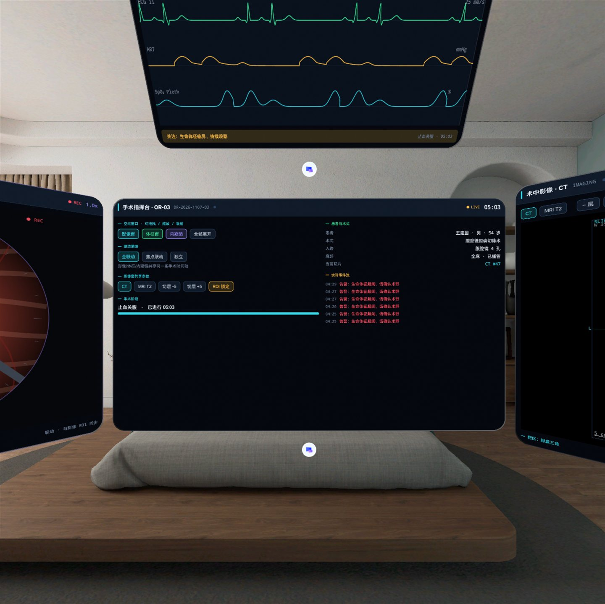

# SurgPanel · 空间多悬浮窗术中信息面板

面向 **PICO Space Program 2026「最佳 PICO Spatial 空间应用」** 赛道的空间医疗应用原型。
在一台手术室内，把医生真正需要同时盯住的四块信息流搬进空间：**CT/MRI 切面、实时生命体征、主刀内窥镜视野，以及一个总控台**。
四块内容以独立 WindowContainer 存在，可被头部与手势自由摆放、缩放、吸附，同时通过共享会话状态互相联动。

> 技术栈：**纯 Kotlin + PICO Spatial SDK 6.1.9（Compose for Spatial）+ 无 3D 引擎依赖**
> 无头显开发：PICO Emulator（pico-cli 管理，x86_64 镜像）

**语言：** [English](README.md) | 简体中文


---

## 1. 构建与运行

```powershell
# 环境变量（需为纯 ASCII 路径，见下方说明）
$env:PICO_HOME="<pico-home>"
$env:ANDROID_HOME="<android-sdk>"

# 构建
cd <project-root>
.\gradlew.bat assembleDebug

# 模拟器 + 安装 + 启动（pico-cli 0.6.1）
pico-cli emulator start --avd Pico_SurgPanel
pico-cli app install app\build\outputs\apk\debug\app-debug.apk --replace
pico-cli app launch com.cwj.surgpanel
pico-cli capture screenshot --out shots/live.png
```

**路径约束。** Java / GraalVM 系工具链无法处理非 ASCII 路径（含中文用户名），`PICO_HOME`、`ANDROID_HOME`、`GRADLE_USER_HOME` 必须指向 `C:\DevTools\...` 这类纯 ASCII 目录，否则 `pico-cli setup` 与 Gradle daemon 会报 `Illegal char <?>` 或 javaagent JAR 缺失。

---

## 2. 空间布局

| 容器 ID | 内容 | 形态 | 尺寸（dp） | 初始位置 |
| --- | --- | --- | --- | --- |
| `surgical-console`（默认容器） | 手术指挥台：窗口开关、联动策略、患者信息、事件流 | Planar | 1080x640 | 用户正前方 |
| `imaging-panel` | CT/MRI 轴位切面 + 测量/窗宽窗位/切层控制 | Planar | 860x700 | 控制台**右**侧 |
| `vitals-panel` | 心率/血压/血氧/呼末二氧化碳 + 三导波形 | Planar | 780x440 | 控制台**上**方 |
| `scope-panel` | 内窥镜圆形视野 + 器械/皱襞/渗血渲染 | Planar | 720x640 | 控制台**左**侧 |

- 排布使用官方 `Placement.placement(anchor, Orientation.Right/Top/Left, offset)`，锚点由 `PlacementContext.containers` 按 ID 精确选取，锚点缺失时降级 `Placement.none()`，不会因加载顺序崩溃。
- 三个面板的开合通过 `LocalSpatialNavigator.current.openWindowContainer(id, tag)` / `closeWindowContainer(id, tag)` 控制；同一 `id` + 同一 `tag` 走**复用模式**，重复打开只前置窗口，不会堆叠副本。
- 拖拽、缩放、远近自适应由系统 WindowContainer 原生承担（`worldscaletype=1` Dynamic），窗口内部不自行实现手势位移，保证与系统手势一致的手感。

---

## 3. 模块分层

```
com.cwj.surgpanel
├── Main.kt                    空间入口：DefaultWindowContainer + 3 个 WindowContainer 声明与锚定
├── core/
│   ├── SurgicalSession.kt     全局会话状态（Compose State 单源）：体征、切层、模态、联动模式、事件流
│   └── SignalEngine.kt        纯函数信号生成：ECG/ABP/脉搏波形、组织密度场、术野纹理
├── platform/
│   ├── LaunchActivity.kt      承载 Activity
│   ├── SpatialApplication.kt  启动 spatial 树 + 启动手术时钟
│   └── SessionClock.kt        100 ms 步进的数据总线：体征漂移、出血事件、告警判级、阶段推进
└── ui/
    ├── theme/Palette.kt       手术室暗色配色（低亮度、低饱和、告警色分层）
    ├── common/PanelFrame.kt   面板骨架/状态灯/胶囊按钮/键值行/帧时钟
    ├── console/ConsolePage.kt 总控台
    ├── imaging/ImagingPanel.kt
    ├── vitals/VitalsPanel.kt
    └── scope/ScopePanel.kt
```

**关键设计：状态与视图解耦。** 所有面板只读 `SurgicalSession`，所有写入集中在 `SessionClock`（后台守护线程）。因此任一窗口被关闭、重开、移动都不会中断整台手术的数据流，也为后续接入真实设备数据留出替换点——把 `SessionClock` 换成 DICOM/监护仪/内窥镜 SDK 的数据源即可。

---

## 4. 联动机制

| 联动 | 触发 | 表现 |
| --- | --- | --- |
| 生命体征 -> 影像 | 进入 `CRITICAL` 且处于渗血窗口（每 140 s 一轮：40-68 s 渗血，随后 20 s 线性回稳） | 影像窗自动定位到出血相关切层（#46），ROI 脉动高亮，事件流记录告警 |
| 影像 -> 体征 | 切换模态（CT/MRI）或切层 | 波形区与数值区同步标注当前扫描上下文 |
| 内窥镜 -> 影像 | 视野放大倍数变化（联动开启时） | 影像窗 ROI 尺寸与放大倍数保持一致，形成"看哪放大哪"的一致语义 |
| 告警 -> 全线 | 体征超阈 | 三个面板状态灯统一转红，控制台事件流打点 |

联动强度可在控制台三档切换：`FULL`（全部联动）/ `PARTIAL`（仅视觉同步）/ `OFF`（各窗口独立，用于对照演示）。

**告警判级采用回滞（hysteresis）**：进入 `CRITICAL` 用高阈值（HR>112 / SBP<90 / SpO2<94），退出用低阈值（HR<=106 且 SBP>=96 且 SpO2>=95）；`WATCH` 同理（进 HR>96，出 HR<=90）。抖动被消除，状态灯与事件流不会在阈值边缘反复翻转——实测日志中一次完整事件只有 3 条状态转换记录：

```
alarm=NONE      t=0s    hr=82  sbp=118 spo2=98  bleed=false
alarm=CRITICAL  t=40s   hr=130 sbp=83  spo2=93  bleed=true
alarm=NONE      t=68s+  hr=79  sbp=116 spo2=99  bleed=false
```

控制台「事件演示」区提供 **诱发术野渗血**（手动切换渗血状态）与 **时间轴复位**（归零重放），保证路演时不依赖等待周期事件。

---

## 5. 评分权重对齐

| 维度 | 权重 | 本项目落点 |
| --- | --- | --- |
| 创新 | 25 | 术中"多源信息空间编排"而非单窗口移植：告警驱动的自动聚焦、视野放大的 ROI 语义同步、可切换的联动强度 |
| 功能 | 25 | 四条数据流均为真实运行的动态模拟（100 ms 节拍），含出血事件、阶段推进、告警判级，不是静态贴图 |
| 界面 | 15 | 统一暗色医疗配色与信息层级（数值 -> 波形 -> 状态条），面板骨架复用，四窗口视觉语言一致 |
| 交互 | 15 | 多窗口为基本要求：4 个独立容器、系统原生拖拽/缩放/动态缩放、窗口开合与复用 tag、锚定式初始排布 |
| 完成度 | 10 | 可编译可安装可运行，模拟器实测通过；结构分层清晰，无 TODO 空壳 |
| 路演 | 10 | 单机一键启动，演示路径明确：切模态 -> 拖动窗口 -> 等待出血事件触发联动 |

---

## 6. 后续扩展路线

1. **真实影像**：`ImagingPanel` 的位图烘焙函数替换为 DICOM 解码（dcm4che 轻量裁剪版），切层轴取自 Series 的 ImageOrientationPatient。
2. **真实体征**：`SessionClock` 改为 WebSocket / HL7 v2 适配器，保留同样的 State 出口。
3. **空间增强**：引入 Spatial Editor 产出的器官模型（.usdz），以 `Form.Volumetric` 展示，与 Planar 面板做 depth 关系；使用 `LocalVolumeViewPointManager` 做视角驱动的重点区域提示。
4. **手眼协同**：接入 `spatial.ui.sense` / `tracking`，实现"注视即聚焦"、捏合拖动距离锁定、双手缩放。
5. **性能**：波形 Canvas 采样步长自适应、切面位图 LRU 缓存（当前每帧按需重绘，模拟器上已稳定）。

---

## 7. 截图

均为 PICO Emulator 实拍（`adb exec-out screencap`）。

| 视图 | 说明 |
| --- | --- |
|  | **锚定排布**：控制台居中，影像居右、体征居上、内窥镜居左。 |
|  | **渗血告警**：红色告警条 + 三窗状态灯转红，影像自动切到 #46 层。 |
|  | **回稳后**：20 s 线性回稳结束，状态灯恢复绿色，事件流收敛。 |
|  | **动态数据流**：波形与数值按 100 ms 节拍刷新。 |

---

*为 PICO Space Program 2026 开发。纯 Kotlin + PICO Spatial SDK，不依赖 Unity 或任何第三方 3D 引擎。*
