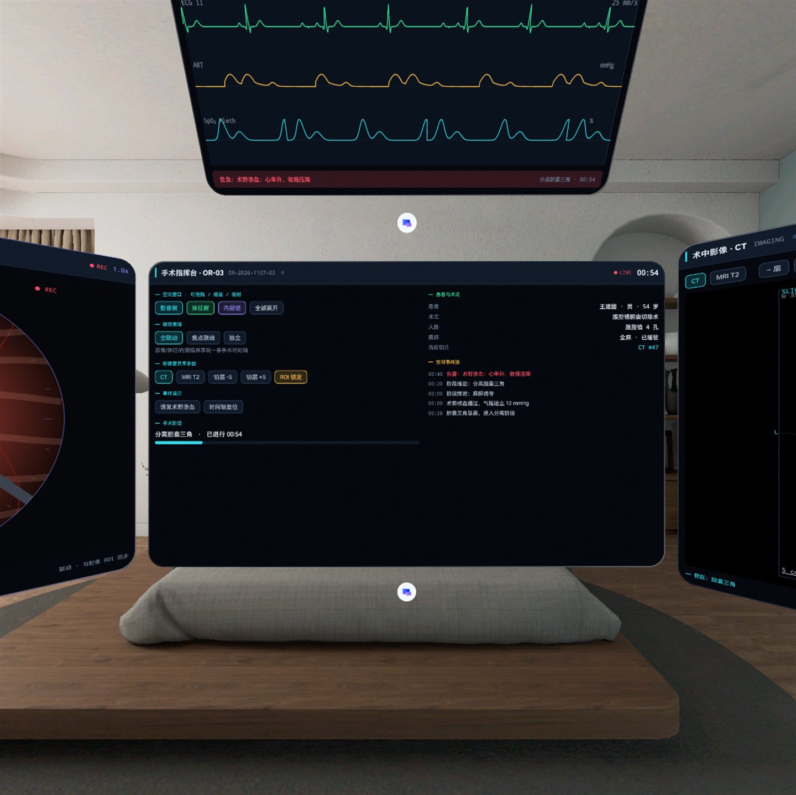
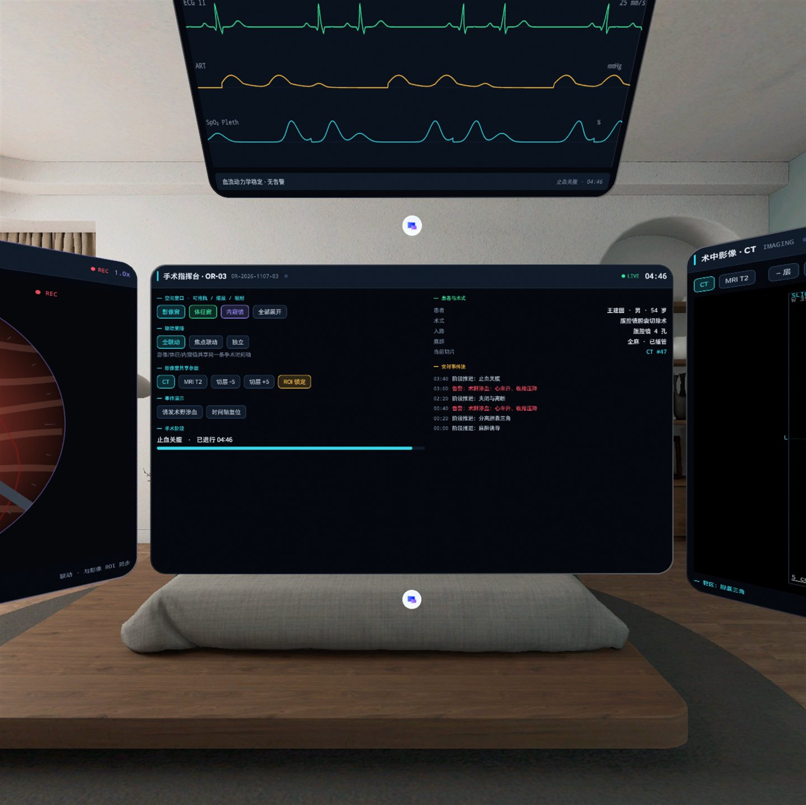

# SurgPanel · 空间多悬浮窗术中信息面板

面向 **PICO Space Program 2026「最佳 PICO Spatial 空间应用」** 赛道的空间医疗应用原型。
在一台手术室内，把医生真正需要同时盯住的四块信息流搬进空间：**CT/MRI 切面、实时生命体征、主刀内窥镜视野，以及一个总控台**。
四块内容以独立 WindowContainer 存在，可被头部与手势自由摆放、缩放、吸附，同时通过共享会话状态互相联动。

> 技术栈：**纯 Kotlin + PICO Spatial SDK 6.1.9（Compose for Spatial）+ 无 3D 引擎依赖**
> 无头显开发：PICO Emulator（pico-cli 管理，x86_64 镜像）
> 版本：**v1.2.1**（versionCode 3）—— 帧上报去重、会话日志单线程化、各面板动画时钟下沉

**语言：** [English](README.md) | 简体中文


---

## 1. 构建与运行

```powershell
# 环境变量（需为纯 ASCII 路径，见下方说明）
$env:PICO_HOME="<pico-home>"
$env:ANDROID_HOME="<android-sdk>"

# 构建
cd <project-root>
.\gradlew.bat assembleDebug

# 模拟器 + 安装 + 启动（pico-cli 0.6.1）
pico-cli emulator start --avd Pico_SurgPanel
pico-cli app install app\build\outputs\apk\debug\app-debug.apk --replace
pico-cli app launch com.cwj.surgpanel
pico-cli capture screenshot --out shots/live.png
```

**路径约束。** Java / GraalVM 系工具链无法处理非 ASCII 路径（含中文用户名），`PICO_HOME`、`ANDROID_HOME`、`GRADLE_USER_HOME` 必须指向 `C:\DevTools\...` 这类纯 ASCII 目录，否则 `pico-cli setup` 与 Gradle daemon 会报 `Illegal char <?>` 或 javaagent JAR 缺失。

---

## 2. 空间布局

| 容器 ID | 内容 | 形态 | 尺寸（dp） | 初始位置 |
| --- | --- | --- | --- | --- |
| `surgical-console`（默认容器） | 手术指挥台：窗口开关、联动策略、患者信息、事件流 | Planar | 1080x640 | 用户正前方 |
| `imaging-panel` | CT/MRI 轴位切面 + 测量/窗宽窗位/切层控制 | Planar | 860x700 | 控制台**右**侧 |
| `vitals-panel` | 心率/血压/血氧/呼末二氧化碳 + 三导波形 | Planar | 780x440 | 控制台**上**方 |
| `scope-panel` | 内窥镜圆形视野 + 器械/皱襞/渗血渲染 | Planar | 720x640 | 控制台**左**侧 |
| `focus-panel` | 智能异常处置：虚拟放大、剖面剖切、证据与处置建议 | Planar | 760x780 | 控制台左侧，出现异常时自动前置 |
| `record-panel` | 无接触病历调阅：既往病史、影像与过敏史要点，流式文本呈现 | Planar | 560x400 | 默认不开启；唤出后位于影像窗右侧 |

- 排布使用官方 `Placement.placement(anchor, Orientation.Right/Top/Left, offset)`，锚点由 `PlacementContext.containers` 按 ID 精确选取，锚点缺失时降级 `Placement.none()`，不会因加载顺序崩溃。
- 三个面板的开合通过 `LocalSpatialNavigator.current.openWindowContainer(id, tag)` / `closeWindowContainer(id, tag)` 控制；同一 `id` + 同一 `tag` 走**复用模式**，重复打开只前置窗口，不会堆叠副本。
- 拖拽、缩放、远近自适应由系统 WindowContainer 原生承担（`worldscaletype=1` Dynamic），窗口内部不自行实现手势位移，保证与系统手势一致的手感。

---

## 3. 模块分层

```
com.cwj.surgpanel
├── Main.kt                    空间入口：DefaultWindowContainer + 3 个 WindowContainer 声明与锚定
├── core/
│   ├── SurgicalSession.kt     全局会话状态（Compose State 单源）：体征、切层、模态、运行模式、异常事件、事件流
│   ├── SignalEngine.kt        纯函数信号生成：ECG/ABP/脉搏波形、组织密度场、术野纹理
│   ├── AppMode.kt             运行模式枚举（产品 / 演示）与显示徽标
│   ├── AiModels.kt            异常事件、聚焦阶段、证据、处置建议与请求/响应契约
│   ├── AiController.kt        五阶段链路：定位 -> 放大 -> 剖切 -> 分析 -> 处置
│   ├── AiNarrator.kt          叙事块流式打字机：token 队列、一块一任务、可取消
│   ├── CaseRecord.kt          病历条目数据，供无接触病历面板调阅
│   ├── VoiceCommandRouter.kt  语音文法：口令归一化、出血查询匹配、告警意图分发
│   ├── WindowPoseModel.kt     五窗设计位姿（米制，原点为指挥台中心）
│   └── PerfGovernor.kt        仅视觉降级：重绘帧率与波形采样步长，别的什么都不碰
├── data/
│   ├── InstrumentPort.kt      仪器接口层（体征 / 影像 / 内窥镜）与产品模式注册表
│   └── AiAdvisor.kt           AI 接口层：远程 HTTP JSON 推理 + 本地规则引擎兜底
├── platform/
│   ├── LaunchActivity.kt      承载 Activity
│   ├── SpatialApplication.kt  启动 spatial 树 + 启动手术时钟
│   ├── SessionClock.kt        100 ms 步进的数据总线：体征漂移、外部设备帧、出血事件、告警判级、阶段推进
│   ├── GazePinchController.kt 眼动射线 + HMD 射线兜底、注视驻留高亮、捏合确认
│   └── VoiceInput.kt          控制台麦克风按钮背后的系统语音识别封装
└── ui/
    ├── theme/Palette.kt       手术室暗色配色（低亮度、低饱和、告警色分层）
    ├── common/PanelFrame.kt   面板骨架/状态灯/胶囊按钮/主按钮/键值行/帧时钟
├── common/MiniRadar.kt    五窗俯视 2D 雷达与实时坐标栈
    ├── console/ConsolePage.kt 总控台：模式切换与前方测试按钮
    ├── imaging/ImagingPanel.kt
    ├── vitals/VitalsPanel.kt
    ├── scope/ScopePanel.kt
    ├── focus/FocusPanel.kt    智能异常处置：放大、剖切、证据与处置建议
    └── record/RecordPanel.kt  无接触病历面板：眼动/语音唤出、病史流式输出、NO-TOUCH 标识
```

**注视、捏合与语音。** `GazePinchController` 把眼动前向向量与五个窗口平面求交、取最近命中；同一命中持续到 750 ms 驻留窗口的三分之一，该窗口即点亮为聚焦态。聚焦态下捏合强度越过 0.82 触发该窗注册的确认回调，随后锁定 700 ms，一次物理捏合不会触发两次确认。眼动不可用时自动退回 HMD 射线，因此没有眼动追踪的硬件上高亮依然可用。控制台麦克风按钮接系统 `SpeechRecognizer`，口令“立刻查看出血点”（含少量近义变体）会把告警置为危急、置亮出血标记并把聚焦窗前置，走的是与仪器告警同一条状态路径。

**性能契约。** `PerfGovernor` 只能节流“画”的部分：`visualHz` 60 / 30 / 20、`waveStride` 2 / 3.4 / 5，仅作用于 Canvas 波形。`SessionClock` 的 100 ms 守护心跳与告警判级在任何档位都不变；数值文本与红色告警框每次状态变化都重绘；曲线按与帧率无关的步长插值，降帧不会出现跳变；任何情况下都不为省电挂起线程。完整条款见 `docs/architecture.md` 第 15 节。

**关键设计：状态与视图解耦。** 所有面板只读 `SurgicalSession`，所有写入集中在 `SessionClock`（后台守护线程）。因此任一窗口被关闭、重开、移动都不会中断整台手术的数据流，也为后续接入真实设备数据留出替换点——把 `SessionClock` 换成 DICOM/监护仪/内窥镜 SDK 的数据源即可。

---

## 4. 运行模式

控制台可在两种模式间切换。两种模式驱动同一批面板与同一份会话状态，因此接入真实设备时空间布局不变。

| | 演示模式 | 产品模式 |
| --- | --- | --- |
| 数据来源 | `SessionClock` 本地推演，确定性强、可重复 | 从 `InstrumentRegistry` 轮询真实帧；未接入设备时回落到本地推演 |
| 触发方式 | 面前测试按钮一键触发 | 自动：`SessionClock` 的告警判级调用 `AiController.onAlarmTriggered` |
| 用途 | 路演、回归验证，每次点击结果一致 | 真实仪器 + 远程推理服务实盘使用 |

**演示模式**：整条链路收在一个放在医生正前方的按钮后面。点击一次即注入术中渗血场景，聚焦窗按「定位 -> 放大 -> 剖切 -> 分析 -> 处置」推进，全程约 16 s，结束后结论留在屏幕上；运行中再次点击即收起，控制台的「时间轴复位」也会清空事件。

**产品模式**：同一条链路，两端换成接口：

| 接口 | 文件 | 契约 |
| --- | --- | --- |
| 监护仪 / 麻醉机 / 中央站 | `data/InstrumentPort.kt` -> `VitalSignSource` | `open()` / `poll(): VitalsFrame?` / `close()`，通过 `InstrumentRegistry.attachVitals` 注册 |
| PACS / DICOM 工作站 / 术中 C 臂 | `InstrumentPort.kt` -> `ImagingSource` | `sliceCount()`、`pollSliceIndex()`，通过 `attachImaging` 注册 |
| 术野摄像 | `InstrumentPort.kt` -> `EndoscopeSource` | `pollZoom()`，通过 `attachEndoscope` 注册 |
| AI 服务 | `data/AiAdvisor.kt` -> `AiAdvisor` | `RemoteAiAdvisor(endpoint, apiKey, model)` 以原生 HTTP JSON 请求（连接 2.5 s / 读取 3 s）；超时或非 2xx 一律回落到 `LocalAiAdvisor`，断网不会中断手术 |

部署方只需填写 `AiGateway.endpoint` / `apiKey` / `model`，代码中不写死任何厂商信息。请求体携带病例、患者、体征快照、当前断面与触发来源；响应按 `region` / `cause` / `targetSlice` / `confidence` / `findings[]` / `actions[]` 解析。

**AI 辅助链路**（`core/AiController.kt`）在异常出现时依次呈现：

1. **监控**——体征按 100 ms 分级，产品模式下 `CRITICAL` 自动启动链路，演示模式下由按钮启动。
2. **放大**——独立的 `focus-panel` 自动出现在医生正前方，患者相应部位以 3.4x 虚拟放大呈现，带比例尺与脉动病灶标记。
3. **剖切**——同一画布过渡为剖面：组织层次、出血血管与深度标尺。
4. **分析**——逐条列证据并附实测数据（收缩压斜率、代偿心率、断面序号、血凝块尺寸）。
5. **处置**——按优先级给出措施、器械与时限，例如夹闭供血分支、下调气腹压、加压晶体液、启动备血。

所有面板都不直接访问网络或设备：数据统一写入单一会话状态，因此整条链路可逐帧复现。

---

## 5. 联动机制

| 联动 | 触发 | 表现 |
| --- | --- | --- |
| 生命体征 -> 影像 | 进入 `CRITICAL` 且处于渗血窗口（每 140 s 一轮：40-68 s 渗血，随后 20 s 线性回稳） | 影像窗自动定位到出血相关切层（#46），ROI 脉动高亮，事件流记录告警 |
| 影像 -> 体征 | 切换模态（CT/MRI）或切层 | 波形区与数值区同步标注当前扫描上下文 |
| 内窥镜 -> 影像 | 视野放大倍数变化（联动开启时） | 影像窗 ROI 尺寸与放大倍数保持一致，形成"看哪放大哪"的一致语义 |
| 告警 -> 全线 | 体征超阈 | 三个面板状态灯统一转红，控制台事件流打点 |

联动强度可在控制台三档切换：`FULL`（全部联动）/ `PARTIAL`（仅视觉同步）/ `OFF`（各窗口独立，用于对照演示）。

**告警判级采用回滞（hysteresis）**：进入 `CRITICAL` 用高阈值（HR>112 / SBP<90 / SpO2<94），退出用低阈值（HR<=106 且 SBP>=96 且 SpO2>=95）；`WATCH` 同理（进 HR>96，出 HR<=90）。抖动被消除，状态灯与事件流不会在阈值边缘反复翻转——实测日志中一次完整事件只有 3 条状态转换记录：

```
alarm=NONE      t=0s    hr=82  sbp=118 spo2=98  bleed=false
alarm=CRITICAL  t=40s   hr=130 sbp=83  spo2=93  bleed=true
alarm=NONE      t=68s+  hr=79  sbp=116 spo2=99  bleed=false
```

控制台「事件演示」区提供 **诱发术野渗血**（手动切换渗血状态）与 **时间轴复位**（归零重放），保证路演时不依赖等待周期事件。

---

## 6. 手术室痛点覆盖

以下四件事决定空间面板在真实手术室里是否可用，而不是只在路演 PPT 上成立。四项均已在本次代码中落地。

### 6.1 无菌与调阅的矛盾：无接触病历调阅

刷手后的主刀不能自己挠头，更不能走过去碰工作站；现在的唯一通道是口述给巡回护士。

- 注视控制台窗口行里的**病历窗**按钮，或直接说「调出患者半年前的冠脉 CT」，一块紧凑的 `record-panel`（560x400）就展开在影像窗右侧，表头带 `NO-TOUCH` 指示灯，让全手术室都能看懂这套交互模型。
- 条目区标题是“调阅条目 · 注视即切换”：注视某一条即切换病例，全程没有点击。病史用与 AI 建议同一套打字机管线逐字流出（`AiNarrator`：一块一任务、可取消，后台调度器上 22 ms/token，刻意不挂在 100 ms 数据线程上），文本按口述交接的节奏出现，而不是一次性贴满屏。
- 说一句「关闭」窗口即收。眼动与语音是唯一输入，触摸屏不在这条链路里。

> 实现了完全基于眼动与语音的“无接触无菌交互”，将医生从“必须洗手才能碰设备”的困境中解放出来。

### 6.2 警报疲劳：多参数交叉验证

一个什么都要叫的监护阵列，会把主刀训练成听不见任何声音。

- `SessionClock` 每 100 ms 判定三条独立信号：**心率 > 120**、**收缩压 < 90**、**内窥镜渗出评分 >= 0.62**（评分来自 `SignalEngine.exudateScore` 的组织模型）。只有三项同时满足并保持 1.5 s 才升到 `CRITICAL`——红框闪烁 + 165 ms 急促音；事件日志会打印 `fusion=3[true,true,true]` 供复核。
- 单项偏高**不触发任何警报**：只在控制台角落亮一个青色小点，体征流程条显示“交叉验证 1/3”并标出是哪一路越限，因此心率 121 单独出现永远不会打断术者。
- 闸门之外还叠了回滞（进入 HR>112 / SBP<90 / SpO2<94，退出 HR<=106 且 SBP>=96 且 SpO2>=95），一次事件稳定只产生三条日志，不会在阈值边缘抖动。

> 引入了多参数交叉验证的告警机制，有效降低了手术室“警报疲劳”，确保主刀医生的注意力只被真正的危急事件（如急性大出血）打断。

### 6.3 关键时间与耗材追踪

阻断时间、纱布清点与出血量，是空间控制台真正能接管的物流。

- 说「开始阻断」，15:00 的上限会提为波形上方整行大字（26 sp 等宽），因为流程计时必须在一臂之外读得清。剩 3 分钟转琥珀、剩 1 分钟转红；到 15:00 自动解除并把最终时长写入日志，说「结束阻断」则提前归档。
- 流程条同时展示**估算出血 EBL**（出血时 0.55 ml/tick，平时 0.015 ml/tick）与**纱布 台上/清点**：每次渗血边沿都会让台上纱布数加一，因此关腹前必须对上的那个数字始终在屏幕上。
- 三项都读同一份会话状态，窗口移走、关闭、重开都不影响计数。

> 不仅关注生理指标，更将手术室关键流程（如血管阻断倒计时、大出血估算）纳入空间管理，打造真正的“全维手术指挥舱”。

### 6.4 主刀视角共享

主刀看得到病灶，却没法让助手看到“我正在看哪里”。

- 内窥镜面板用**注视点四角括号**框出当前注视位置，任何戴着这台头显的人都能看到“我在看的那根分支”。
- 开启教学同步后该框变绿并标注 `GAZE ▸ 教学端 3 端`，日志记录“已同步至教学端 · 3 个接入点（来源：触发它的口令）”。“同步教学端”本身就是一条语音意图，整套带教交接不需要任何手柄。

> 通过空间面板的视角同步，不仅辅助主刀医生，更为医学教学和远程会诊提供了第一人称视角的“沉浸式带教”。

---

## 7. 评分权重对齐

| 维度 | 权重 | 本项目落点 |
| --- | --- | --- |
| 创新 | 25 | 术中"多源信息空间编排"而非单窗口移植：告警驱动的自动聚焦、视野放大的 ROI 语义同步、可切换的联动强度 |
| 功能 | 25 | 四条数据流均为真实运行的动态模拟（100 ms 节拍），含出血事件、阶段推进、告警判级，不是静态贴图 |
| 界面 | 15 | 统一暗色医疗配色与信息层级（数值 -> 波形 -> 状态条），面板骨架复用，四窗口视觉语言一致 |
| 交互 | 15 | 多窗口为基本要求：4 个独立容器、系统原生拖拽/缩放/动态缩放、窗口开合与复用 tag、锚定式初始排布 |
| 完成度 | 10 | 可编译可安装可运行，模拟器实测通过；结构分层清晰，无 TODO 空壳 |
| 路演 | 10 | 单机一键启动，演示路径明确：切模态 -> 拖动窗口 -> 等待出血事件触发联动 |

---

## 8. 后续扩展路线

1. **真实影像**：`ImagingPanel` 的位图烘焙函数替换为 DICOM 解码（dcm4che 轻量裁剪版），切层轴取自 Series 的 ImageOrientationPatient。
2. **真实仪器**：实现 `VitalSignSource` / `ImagingSource` / `EndoscopeSource` 适配（WebSocket / HL7 v2 / DICOM 网关 / 串口），注册进 `InstrumentRegistry` 即可，面板代码零改动。
3. **空间增强**：引入 Spatial Editor 产出的器官模型（.usdz），以 `Form.Volumetric` 展示，与 Planar 面板做 depth 关系；使用 `LocalVolumeViewPointManager` 做视角驱动的重点区域提示。
4. **手眼协同**：接入 `spatial.ui.sense` / `tracking`，实现"注视即聚焦"、捏合拖动距离锁定、双手缩放。
5. **性能**：波形 Canvas 采样步长自适应、切面位图 LRU 缓存（当前每帧按需重绘，模拟器上已稳定）。

---

## 9. 截图

均为 PICO Emulator 实拍（`adb exec-out screencap`）。

| 视图 | 说明 |
| --- | --- |
|  | **锚定排布**：控制台居中，影像居右、体征居上、内窥镜居左。 |
|  | **渗血告警**：红色告警条 + 三窗状态灯转红，影像自动切到 #46 层。 |
|  | **回稳后**：20 s 线性回稳结束，状态灯恢复绿色，事件流收敛。 |
|  | **动态数据流**：波形与数值按 100 ms 节拍刷新。 |

---

*为 PICO Space Program 2026 开发。纯 Kotlin + PICO Spatial SDK，不依赖 Unity 或任何第三方 3D 引擎。*
